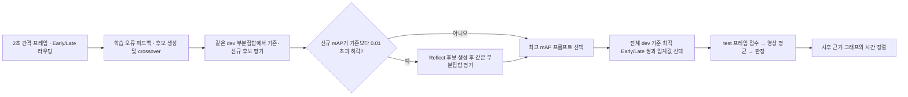

# TEMPO 구조와 가드레일

## 실행 출처

- 실행 ID `vdc_reflect_full_qwen_seed42`, 진입점 `experiment2/vdc_reflect_full.py`.
- 모델 `Qwen2.5-VL-72B-Instruct-AWQ`, `awq_marlin`, FP16, TP 2, GPU 메모리 할당 비율 0.85, 최대 길이 8192, 동시 시퀀스 4, 프롬프트당 이미지 1장, seed 42. 실행 로그 4번째 줄의 초기화 설정을 옮겼다.
- `70e57b38e8b65cd39b11c1ffef335e13fb0fd1dd`는 실행 이후의 코드·결과 보관 커밋이다. 커밋 안의 결과가 로컬 원본과 바이트 단위로 일치한다. 실행 당시 `git HEAD`는 보존되지 않았다. 실제 로그의 `[VDC Reflect]` 형식과 보관 코드의 `[VDC Update]` 형식에는 차이가 있다. 아래 동작은 보관 코드와 실행 로그의 점수·선택 기록을 대조했다.
- 결과 `vdc_reflect_full_qwen_seed42.json` SHA-256 `495c98a15c17a37dc1c6e4cd175d94f0bda29ce190c3105f3e36b259a826bc07`.
- 로그 `vdc_reflect_full_qwen_seed42.log` SHA-256 `9d1d49bd4d956c621a74b4f33233c12952258a5faa0c5420481967f035d5eb7d`.

## 최적화와 최종 판정

1. 학습 360, dev 120, test 121개를 seed 42의 층화 분할로 사용했다. OpenCV로 최대 150초 범위에서 2초 간격 프레임을 뽑고 448×448로 변환한다. `segmentation.json`의 시점 라벨이 우선이다. 라벨이 없으면 프레임 순서의 앞·뒤 절반을 사용한다. [보관 코드](../code_snapshot/experiment2/tempo_cov.py#L200)
2. 한 라운드에서 Early와 Late를 차례로 업데이트한다. 상대 구간 프롬프트를 고정하고 균형 학습 미니배치(최대 32개)의 오류 피드백으로 후보 3개를 만든다. Crossover는 후보와 프롬프트 메모리의 상위 후보를 합쳐 신규 프롬프트 하나를 만든다. 전체 dev로 라운드별 최적 쌍을 추적한다. 실행 로그는 12라운드를 기록하며 6라운드 종료 후 도구 활성화를 기록했다. [보관 코드](../code_snapshot/experiment2/tempo_cov.py#L414)
3. 가드가 같은 dev 영상 부분집합(최대 50개)에서 `current`와 `new`의 영상 mAP를 비교한다. `new_map < current_map - 0.01`일 때만 Reflect 후보를 추가 생성·평가한다. `max(..., key=mAP)`로 기존/신규/평가된 Reflect 중 선택한다. mAP 동점이면 목록 순서상 기존 프롬프트가 우선한다. `force_reflect=false`였다. [보관 코드](../code_snapshot/experiment_intern/vdc_reflect_smoke.py#L133)
4. 정해진 Early/Late 쌍으로 최종 dev/test를 평가한다. Qwen은 프레임당 이미지 1장과 구간 프롬프트를 받아 수치 하나를 출력한다. 단계 2에서 Early 라우팅은 피드백 메모리 조건에 따라 제목·채널·ASR·설명·RAG·웹검색을 프롬프트에 추가할 수 있다. Late는 시각 입력과 프롬프트를 사용한다. 결과에는 영상별 도구 선택이나 추가된 문구가 기록되지 않았다. [라우팅 코드](../code_snapshot/experiment2/tempo_cov.py#L235) · [도구 주입 코드](../code_snapshot/experiment2/tempo_cov.py#L146)
5. 저장된 유효 프레임 점수의 산술 평균으로 영상 점수를 계산하고, `평균 >= 0.28`이면 사기로 판정한다. 0.28은 전체 dev에서 영상 F1을 최대화한 임계값이다. 가드는 최적화에서 프롬프트를 고르므로 선택이 달라지면 이후 점수와 판정이 달라질 수 있다. 이 실행에는 가드가 개별 test 점수를 사후 수정하거나 판정을 덮어쓰는 단계가 없다. 동일 실행 로그로는 가드 유무에 따른 개별 영상의 반사실 판정을 알 수 없다. [평가 코드](../code_snapshot/utils.py#L96)

## 실제 실행 로그 예시

원본 로그에서 점수·선택 필드를 발췌했다. 화면 개인정보와 학습 피드백 자유 텍스트는 발행 범위에서 제외했다.

| 원본 줄 | 구간 | 기존 mAP | 신규 mAP | Reflect mAP | 선택 |
|---|---|---:|---:|---:|---|
| 130 | Early | 0.338040 | 0.434153 | — | 신규 |
| 161 | Early | 0.467819 | 0.421455 | 0.440136 | 기존 |
| 303 | Late | 0.773610 | 0.771101 | — | 기존 |

24회에서 기존 17회, 신규 7회가 선택됐다. Reflect는 16회 생성·평가됐고 선택된 횟수는 0회였다. 이 실행의 발표 문구는 **“dev 가드가 하락 후보를 거절했고, Reflect를 추가 평가했다”**로 쓸 수 있다. [로그 발췌](../run/guard_log_extract.json)

| 평가 | 영상 / 프레임 | ROC-AUC | AP(`map`) | F1 | Accuracy |
|---|---:|---:|---:|---:|---:|
| Dev, 기본 임계값 0.50 | 120 / 3,719 | 0.8793 | 0.7693 | 0.7595 | 0.8417 |
| Test, 기본 임계값 0.50 | 121 / 3,320 | 0.8607 | 0.7773 | 0.7391 | 0.8017 |
| Test, dev 임계값 0.28 | 121 / 3,320 | 0.8607 | 0.7773 | 0.7273 | 0.7273 |

`map`은 양성 클래스에 대한 `average_precision_score`다. 영상 판정 CSV는 두 split 모두 0.28을 적용한다. Dev의 원본 `dev` 지표에는 코드 기본값 0.50이 적용돼 있다. KL, macro F1 및 비율 기반 지표도 원본 수치 그대로 포함했다. Test 0.28의 TP/TN/FP/FN은 44/44/31/2다. [전체 지표](../run/metrics.json)

## 발표에서 보여줄 근거의 범위

최종 분류 입력은 당시 추론 프레임과 구간 프롬프트이며, 조건에 따라 Early 도구 문맥이 추가될 수 있다. 기록으로 확인할 수 있는 것은 프레임 시점·구간·점수, 영상 평균과 임계값이다. 화면 문구와 허용 목록 객체는 발표용 관찰이며 특정 객체가 점수를 만든 인과 관계는 남아 있지 않다. 시간 그래프의 `ALIGNS_WITH`는 사후 시점 연결이다. [발표 타임라인](../timeline/README.md)
